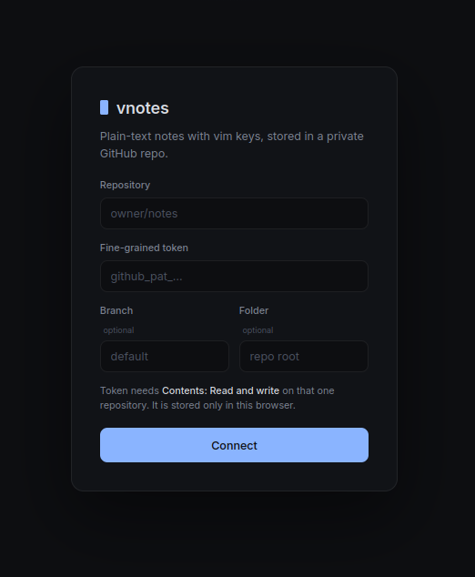
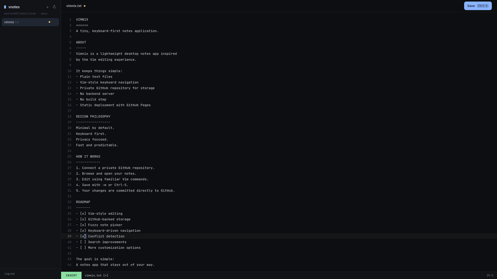
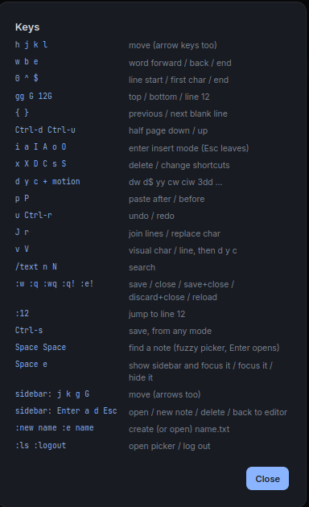

# Vimnix

A tiny, keyboard-first notes app inspired by Vim.

Vimnix is a minimal desktop notes application that lets you create, edit, and manage plain text notes using familiar Vim-style keyboard commands.

Your notes are stored as `.txt` files in your own private GitHub repository. The application itself is completely static and runs on GitHub Pages.

**No server. No build step. No unnecessary complexity.**

## Features

- **Vim-style editing** - Navigate and edit notes using familiar Vim motions and commands.
- **Plain text storage** - Notes are stored as ordinary `.txt` files.
- **Private GitHub storage** - Your notes live in your own private repository.
- **Fuzzy note picker** - Quickly find and open notes with `Space Space`.
- **Keyboard-first navigation** - Manage notes without relying on a mouse.
- **Sidebar navigation** - Browse, create, and delete notes.
- **Conflict detection** - Prevents accidentally overwriting changes made elsewhere.
- **Unsaved change protection** - Prompts before switching notes or logging out.
- **Lightweight architecture** - Static HTML, CSS, and JavaScript hosted on GitHub Pages.

## Screenshots

### Login


### Editor


### Help & Keyboard Shortcuts


## Getting Started

### 1. Create a private notes repository

Create a GitHub repository for your notes, for example `personal-notes`.

Initialize it with a README so the default branch exists.

### 2. Generate a GitHub token

Go to **GitHub → Settings → Developer settings → Fine-grained personal access tokens**.

Generate a token with the following configuration:

- **Repository access:** Only select repositories
  - Select your private notes repository.
- **Repository permissions:**
  - Contents - **Read and write**
  - Metadata - Read-only (added automatically)

> Keep your token private.

### 3. Deploy Vimnix

Put the application files into a GitHub repository:

```
index.html
style.css
vim.js
app.js
```

Enable GitHub Pages:

1. Open your site repository settings.
2. Navigate to **Pages**.
3. Select **Deploy from a branch**.
4. Choose the `main` branch.
5. Select the root directory.

Your application will be available through GitHub Pages.

> The site repository must be public when using the free GitHub Pages plan. It contains no secrets.

### 4. Connect your notes repository

Open Vimnix and enter:

- GitHub owner
- Notes repository name
- Personal access token
- Optional folder

Your connection details are saved in the browser's `localStorage` so you only need to enter them once. Logging out removes the saved credentials.

## Keyboard Shortcuts

### General

| Shortcut | Action |
| --- | --- |
| `Space Space` | Open fuzzy note picker |
| `Space e` | Toggle sidebar |
| `:help` | Show keyboard reference |
| `:ls` | Open note picker |
| `:new name` | Create a note |
| `:e name` | Open or create a note |

### Sidebar

| Shortcut | Action |
| --- | --- |
| `j` / `k` | Move down / up |
| `g` / `G` | First / last item |
| `Enter` | Open selected note |
| `a` | Create new note |
| `d` | Delete note |
| `Esc` | Return to editor |

### Editing

Vimnix supports familiar Vim motions and editing commands, including:

| Keys | Action |
| --- | --- |
| `h` `j` `k` `l` | Cursor movement |
| `w` `b` `e` | Word navigation |
| `0` `^` `$` | Line navigation |
| `gg` `G` | First and last line |
| `i` `a` `I` `A` | Insert mode |
| `o` `O` | Open a line below or above |
| `x` `X` `D` `C` | Delete and change operations |
| `dd` `yy` `p` `P` | Delete, yank, and paste |
| `u` `Ctrl-r` | Undo and redo |
| `v` `V` | Visual selection |
| `/text` `n` `N` | Search |

### Ex Commands

| Command | Action |
| --- | --- |
| `:w` | Save note |
| `:q` | Close note |
| `:wq` | Save and close |
| `:q!` | Close without saving |
| `:e!` | Reload note |
| `:12` | Jump to line 12 |

`Ctrl-S` also saves the current note.

## How Storage Works

Vimnix communicates directly with the GitHub API.

- The notes list is fetched when needed.
- Opened notes are cached in memory.
- Changes are saved only when you explicitly save.
- Each save creates a GitHub repository update.
- New notes remain local until their first save.

There is no application backend or separate database.

## Security

Your GitHub token is stored in the browser's `localStorage`.

For security:

- Use Vimnix only on your own trusted machine.
- Restrict the token to your notes repository.
- Grant only Contents read and write permissions.
- Never share your token.
- Revoke the token immediately if it is exposed.

Logging out removes the locally stored credentials.

## Built With

- HTML
- CSS
- JavaScript
- GitHub REST API
- GitHub Pages

## Philosophy

Vimnix is built around a simple idea:

> Your notes should belong to you, and your tools should stay out of your way.

No accounts to create, no complicated infrastructure, and no unnecessary features.

Just plain text, Vim keys, and your own private GitHub repository.
